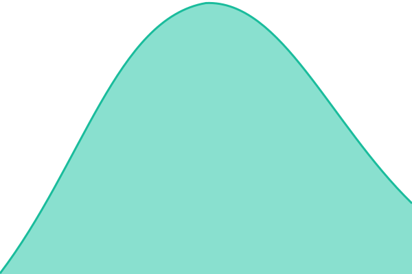
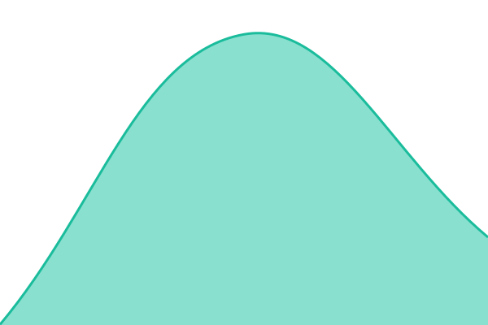

# [📈 Live Status](https://noowxela.github.io/status): <!--live status--> **🟩 All systems operational**

This repository contains the open-source uptime monitor and status page for [Alex Woon Jun ROng](https://noowxela.github.io/portfolio/), powered by [Upptime](https://github.com/upptime/upptime).

With [Upptime](https://upptime.js.org), you can get your own unlimited and free uptime monitor and status page, powered entirely by a GitHub repository. We use [Issues](https://github.com/noowxela/status/issues) as incident reports, [Actions](https://github.com/noowxela/status/actions) as uptime monitors, and [Pages](https://noowxela.github.io/status) for the status page.

<!--start: status pages-->
<!-- This summary is generated by Upptime (https://github.com/upptime/upptime) -->
<!-- Do not edit this manually, your changes will be overwritten -->
<!-- prettier-ignore -->
| URL | Status | History | Response Time | Uptime |
| --- | ------ | ------- | ------------- | ------ |
|  [Japan Trip](https://japan-trip-pi-indol.vercel.app) | 🟩 Up | [japan-trip.yml](https://github.com/noowxela/status/commits/HEAD/history/japan-trip.yml) | 

 2083ms
     
 | 

<a href="https://noowxela.github.io/status/history/japan-trip">100.00%</a>
    

|  [HikeSeeker](https://hikeseeker.vercel.app) | 🟩 Up | [hike-seeker.yml](https://github.com/noowxela/status/commits/HEAD/history/hike-seeker.yml) | 

 445ms
     
 | 

<a href="https://noowxela.github.io/status/history/hike-seeker">100.00%</a>
    

|  [Swiper Gallery](https://swiper-gallery-tau.vercel.app) | 🟩 Up | [swiper-gallery.yml](https://github.com/noowxela/status/commits/HEAD/history/swiper-gallery.yml) | 

 437ms
     
 | 

<a href="https://noowxela.github.io/status/history/swiper-gallery">100.00%</a>
    

|  [Notion Blog](https://notion-blog-mu-peach.vercel.app) | 🟩 Up | [notion-blog.yml](https://github.com/noowxela/status/commits/HEAD/history/notion-blog.yml) | 

 626ms
     
 | 

<a href="https://noowxela.github.io/status/history/notion-blog">100.00%</a>
    

|  [Toolbox API](https://toolbox-api-bdzu.onrender.com/health) | 🟩 Up | [toolbox-api.yml](https://github.com/noowxela/status/commits/HEAD/history/toolbox-api.yml) | 

 32989ms
     
 | 

<a href="https://noowxela.github.io/status/history/toolbox-api">100.00%</a>
    

|  [Portfolio](https://noowxela.github.io/portfolio/) | 🟩 Up | [portfolio.yml](https://github.com/noowxela/status/commits/HEAD/history/portfolio.yml) | 

 146ms
     
 | 

<a href="https://noowxela.github.io/status/history/portfolio">100.00%</a>
    

|  [Resume (PDF)](https://noowxela.github.io/Resume/Alex_Woon_Jun_Rong_Resume.pdf) | 🟩 Up | [resume-pdf.yml](https://github.com/noowxela/status/commits/HEAD/history/resume-pdf.yml) | 

 120ms
     
 | 

<a href="https://noowxela.github.io/status/history/resume-pdf">100.00%</a>
    

|  [Toolbox](https://noowxela.github.io/toolbox/) | 🟩 Up | [toolbox.yml](https://github.com/noowxela/status/commits/HEAD/history/toolbox.yml) | 

 138ms
     
 | 

<a href="https://noowxela.github.io/status/history/toolbox">100.00%</a>
    

|  [KLEC Mid Valley Infographic](https://noowxela.github.io/klec-midvalley-infographic/) | 🟩 Up | [klec-mid-valley-infographic.yml](https://github.com/noowxela/status/commits/HEAD/history/klec-mid-valley-infographic.yml) | 

 140ms
     
 | 

<a href="https://noowxela.github.io/status/history/klec-mid-valley-infographic">100.00%</a>
    

|  [Bukit Jalil Pavilion Infographic](https://noowxela.github.io/bukitjalil-pavilion-infographic/) | 🟩 Up | [bukit-jalil-pavilion-infographic.yml](https://github.com/noowxela/status/commits/HEAD/history/bukit-jalil-pavilion-infographic.yml) | 

 130ms
     
 | 

<a href="https://noowxela.github.io/status/history/bukit-jalil-pavilion-infographic">100.00%</a>
    

|  [Food Picker (Cat Meme)](https://noowxela.github.io/food-picker-catmeme/) | 🟩 Up | [food-picker-cat-meme.yml](https://github.com/noowxela/status/commits/HEAD/history/food-picker-cat-meme.yml) | 

 136ms
     
 | 

<a href="https://noowxela.github.io/status/history/food-picker-cat-meme">100.00%</a>
    

|  [Hanabi Taikai](https://noowxela.github.io/hanabi-taikai/) | 🟩 Up | [hanabi-taikai.yml](https://github.com/noowxela/status/commits/HEAD/history/hanabi-taikai.yml) | 

 137ms
     
 | 

<a href="https://noowxela.github.io/status/history/hanabi-taikai">100.00%</a>
    

|  [Playroom](https://noowxela.github.io/playroom/) | 🟩 Up | [playroom.yml](https://github.com/noowxela/status/commits/HEAD/history/playroom.yml) | 

 139ms
     
 | 

<a href="https://noowxela.github.io/status/history/playroom">100.00%</a>
    

|  [Badminton Score](https://noowxela.github.io/BadmintonScore/) | 🟩 Up | [badminton-score.yml](https://github.com/noowxela/status/commits/HEAD/history/badminton-score.yml) | 

 123ms
     
 | 

<a href="https://noowxela.github.io/status/history/badminton-score">100.00%</a>
    

|  [GLB Viewer](https://noowxela.github.io/glb-viewer/) | 🟩 Up | [glb-viewer.yml](https://github.com/noowxela/status/commits/HEAD/history/glb-viewer.yml) | 

 123ms
     
 | 

<a href="https://noowxela.github.io/status/history/glb-viewer">100.00%</a>
    

|  [UI Component Library](https://noowxela.github.io/ui-component-library/) | 🟩 Up | [ui-component-library.yml](https://github.com/noowxela/status/commits/HEAD/history/ui-component-library.yml) | 

 132ms
     
 | 

<a href="https://noowxela.github.io/status/history/ui-component-library">100.00%</a>
    

<!--end: status pages-->

[**Visit our status website →**](https://noowxela.github.io/status)

## 📄 License

- Powered by: [Upptime](https://github.com/upptime/upptime)
- Code: [MIT](./LICENSE) © [Anand Chowdhary](https://anandchowdhary.com)
- Data in the `./history` directory: [Open Database License](https://opendatacommons.org/licenses/odbl/1-0/)
